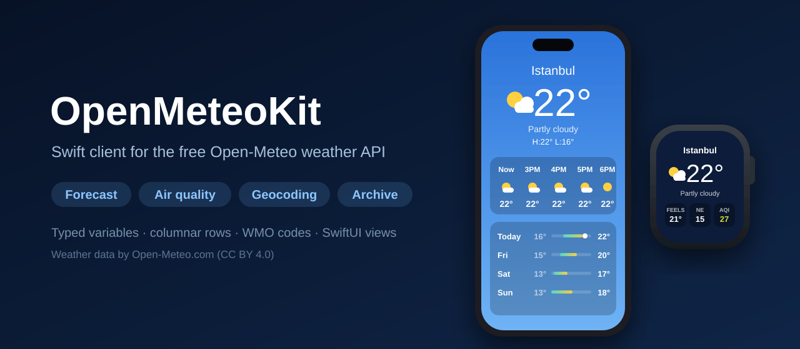
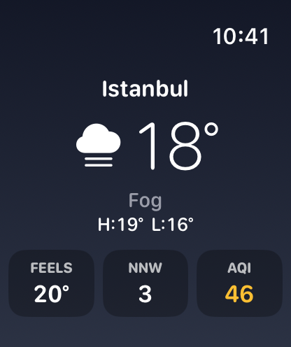
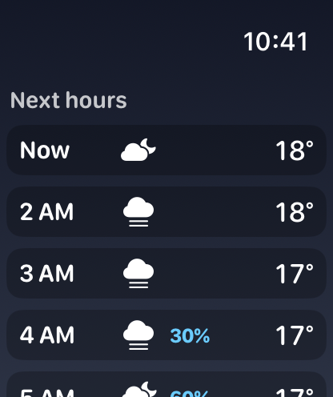
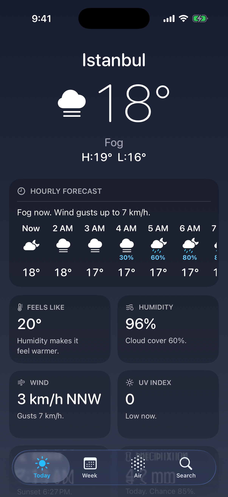
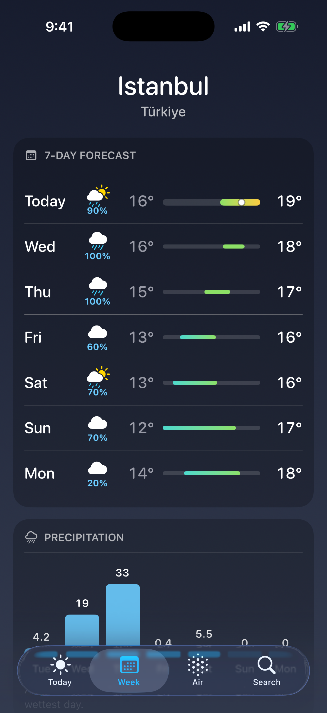

<p align="center">
  
</p>

<p align="center">
  <a href="https://github.com/halilozel1903/OpenMeteoKit/actions/workflows/ci.yml"></a>
  
  
  
  
  
  
  <a href="LICENSE"></a>
</p>

**OpenMeteoKit** is a Swift client for the free [Open-Meteo](https://open-meteo.com) weather API, with SwiftUI views and an example **Apple Watch and iPhone** app. Ask for current conditions, hourly and daily forecasts with **typed variables**, search places with the geocoding API, read air quality and look up past weather back to 1940. Open-Meteo answers with one array per variable; OpenMeteoKit turns those columns into **rows** (`HourlyWeather`, `DailyWeather`, `AirQualityReading`) and every WMO weather code into a description and a day or night **SF Symbol**. No API key, no dependencies.

```swift
import OpenMeteoKit

let weather = OpenMeteoClient()

let places = try await weather.searchLocations("Istanbul")
let forecast = try await weather.forecast(ForecastRequest(coordinate: places[0].coordinate))

if let now = forecast.current {
    print(now.temperature ?? 0)                              // 21.9, in °C
    print(now.weatherCode?.description ?? "")                // "Partly cloudy"
    print(now.weatherCode?.symbolName(isDay: now.isDay) ?? "") // "cloud.sun.fill"
}
for hour in forecast.upcomingHours(6) {
    print(hour.time, hour.temperature ?? 0, hour.precipitationProbability ?? 0)
}
```

## Screenshots

Captured by CI from the example app, *Breeze*, on an Apple Watch and an iPhone simulator. The screenshot scenes load Istanbul's real forecast and air quality from the live Open-Meteo API at the time CI ran, so the numbers in them are whatever the weather was then; if the API cannot be reached, the job fails instead of saving a capture.

| Watch: now | Watch: next hours |
| :---: | :---: |
|  |  |

| iPhone: today | iPhone: week |
| :---: | :---: |
|  |  |

## Features

- **Every free endpoint**: the forecast (`/v1/forecast`), historical weather (`/v1/archive`), air quality (`/v1/air-quality`) and geocoding (`/v1/search`, `/v1/get`), each an `async throws` method. `get(_:query:as:)` reaches any other Open-Meteo API (marine, flood, ensemble…) with the same request handling.
- **Typed variables**: `HourlyVariable` (also used for current conditions), `DailyVariable` and `AirQualityVariable` map to Open-Meteo's names (`.temperature2m` is `temperature_2m`), so a typo is a compile error instead of a 400. Duplicates are removed and the order is kept.
- **Units and time zones**: `WeatherUnits.metric` or `.imperial`, or any mix of `TemperatureUnit`, `WindSpeedUnit` and `PrecipitationUnit`; only the ones that differ from the API defaults are sent. `timezone=auto` by default, so times and days are local to the place.
- **Columns into rows**: `TimeSeries` keeps the raw columns (`series[.temperature2m]`, `series["cape"]` for variables without a case) and gives rows with `rows`, `upcomingHours(_:)` and `today`. Missing values are `nil`, never zero. ISO 8601 and Unix times both work.
- **WMO weather codes**: all 28 `WeatherCode`s with the WMO description, a short summary ("Sunny" by day, "Clear" by night), a multicolor SF Symbol for day and night, a broad `WeatherCondition` and `hasPrecipitation`.
- **Air quality levels**: `AirQualityLevel` puts the European (EAQI) and US AQI values into their six categories, with titles, severities and a position on a bar of the scale.
- **Formatting**: `WeatherFormat` for temperatures ("22°", "72 °F"), percentages, wind ("15 km/h NE"), precipitation, UV categories, hours and weekdays in the response's time zone; `CompassDirection` for wind directions; `TemperatureScale` for 7-day range bars.
- **SwiftUI, optional**: the `OpenMeteoUI` library has `CurrentConditionsView`, `HourlyForecastStrip`, `HourlyForecastRow`, `DailyForecastRow`, `TemperatureRangeBar`, `AirQualityGauge`, `AirQualityScaleBar`, `WeatherSymbol`, `WeatherBackground` and `OpenMeteoAttributionView`. They run on iPhone, Apple Watch and the Mac.
- **Validated before sending**: out-of-range coordinates, forecast days, past days or date ranges throw `OpenMeteoError.invalidRequest` without a network request, and Open-Meteo's own error reason comes back as `OpenMeteoError.api(reason:statusCode:)`.
- **Testable and tested**: point the client at any `URLSession` and any host. The package's tests answer every request from a `URLProtocol` stub and recorded Istanbul fixtures, on macOS, iOS and watchOS.
- **Swift 6 strict concurrency**: the client and every model are `Sendable`.

## API coverage

| Endpoint | Method |
| --- | --- |
| `GET /v1/forecast` | `forecast(_:)` with a `ForecastRequest`, or `forecast(latitude:longitude:current:hourly:daily:units:timeZone:forecastDays:pastDays:)` → `Forecast` |
| `GET /v1/archive` | `historical(_:)` with a `HistoricalRequest`, or `historical(latitude:longitude:from:to:hourly:daily:units:timeZone:)` → `Forecast` |
| `GET /v1/air-quality` | `airQuality(_:)` with an `AirQualityRequest`, or `airQuality(latitude:longitude:current:hourly:timeZone:forecastDays:)` → `AirQuality` |
| `GET /v1/search` | `searchLocations(_:count:language:countryCode:)` → `[Location]` |
| `GET /v1/get` | `location(id:language:)` → `Location` |
| anything else | `get(_:query:as:)` decodes any endpoint into your own `Decodable`, or into `Forecast` |

## Installation

In Xcode choose **File › Add Package Dependencies…** and enter:

```
https://github.com/halilozel1903/OpenMeteoKit
```

Or add it to `Package.swift`:

```swift
dependencies: [
    .package(url: "https://github.com/halilozel1903/OpenMeteoKit", from: "1.0.0")
],
targets: [
    .target(name: "MyApp", dependencies: [
        .product(name: "OpenMeteoKit", package: "OpenMeteoKit"),
        .product(name: "OpenMeteoUI", package: "OpenMeteoKit"),   // optional SwiftUI views
    ])
]
```

## Usage

### Forecast

```swift
let weather = OpenMeteoClient.shared

var request = ForecastRequest(latitude: 41.01, longitude: 28.95)   // current, hourly and daily presets
request.current = [.temperature2m, .apparentTemperature, .weatherCode, .isDay, .windSpeed10m, .windDirection10m]
request.hourly = [.temperature2m, .weatherCode, .precipitationProbability, .isDay]
request.daily = [.weatherCode, .temperature2mMax, .temperature2mMin, .sunrise, .sunset, .precipitationSum]
request.units = .imperial                      // °F, mph and inches
request.forecastDays = 10                      // up to 16
let forecast = try await weather.forecast(request)

forecast.timeZone                              // Europe/Istanbul, from timezone=auto
forecast.current?.windSpeed                    // Double?
forecast.current?.weather.windCompassDirection // .ne
forecast.today?.sunrise                        // Date?
forecast.dailyWeather.map(\.temperatureMax)    // [Double?], one per day
forecast.hourly?.unit(for: .temperature2m)     // "°F"
```

`ForecastRequest.defaultCurrent`, `.defaultHourly` and `.defaultDaily` ask for what a weather app shows. Pass an empty array to leave a block out.

### Columns and rows

Open-Meteo sends one array per variable. Read them as columns or as rows:

```swift
let hourly = forecast.hourly!                  // TimeSeries<HourlyVariable>
hourly.times                                   // [Date]
hourly[.temperature2m]                         // [Double?]
hourly.value(.weatherCode, at: 14)             // Double?
hourly.index(containing: .now)                 // the row of the current hour

for hour in forecast.upcomingHours(24) {       // HourlyWeather rows from the current hour
    print(hour.time, hour.temperature ?? 0, hour.weatherCode?.symbolName(isDay: hour.isDay ?? true) ?? "")
}
```

### Weather codes

```swift
let code = WeatherCode(rawValue: 80)!          // .slightRainShowers
code.description                               // "Slight rain showers"
code.summary(isDay: true)                      // "Showers"
code.symbolName(isDay: false)                  // "cloud.moon.rain.fill"
code.condition                                 // .rain
code.hasPrecipitation                          // true
```

### Places

```swift
let places = try await weather.searchLocations("Paris", count: 5, language: "fr", countryCode: "FR")
for place in places {
    print(place.name, place.regionDescription, place.timezone ?? "")   // "Paris" "Île-de-France, France" …
}
let place = try await weather.location(id: 745044)     // by GeoNames id
```

Fewer than two characters return an empty array without a request.

### Air quality

```swift
let air = try await weather.airQuality(latitude: 41.01, longitude: 28.95)
if let now = air.current, let level = now.europeanLevel {
    print(level.roundedValue, level.title)       // 27 "Fair"
    print(now.pm2_5 ?? 0, now.usLevel?.title ?? "")
}
let next = air.hourlyReadings.prefix(12)         // [AirQualityReading]
```

### Past weather

```swift
let september = try await weather.historical(
    latitude: 41.01, longitude: 28.95,
    from: CalendarDate(year: 2026, month: 9, day: 1),
    to: CalendarDate(year: 2026, month: 9, day: 30)
)
let wettest = september.dailyWeather.max { ($0.precipitationSum ?? 0) < ($1.precipitationSum ?? 0) }
```

### Errors

```swift
do {
    let forecast = try await weather.forecast(request)
} catch let error as OpenMeteoError {
    switch error {
    case .api(let reason, let status): break     // Open-Meteo's own message, such as an unknown variable
    case .invalidRequest(let reason): break      // checked before sending
    case .http(let status, let url): break
    case .decoding(let type, let description): break
    case .transport(let urlError): break         // offline, timed out, cancelled
    case .invalidResponse: break
    }
}
```

### Commercial use and testing

The free API is for non-commercial use. With a subscription, use the customer servers and your key:

```swift
let client = OpenMeteoClient(configuration: .customer(apiKey: "…"))
```

The client talks to whatever `URLSession` and hosts you give it, so tests can stub every response, and a self-hosted Open-Meteo works the same way:

```swift
let configuration = URLSessionConfiguration.ephemeral
configuration.protocolClasses = [MyStubProtocol.self]

let client = OpenMeteoClient(configuration: OpenMeteoConfiguration(
    endpoints: .host(URL(string: "https://weather.example.com")!),
    session: URLSession(configuration: configuration)
))
```

### SwiftUI views

```swift
import OpenMeteoKit
import OpenMeteoUI

if let current = forecast.current {
    CurrentConditionsView(locationName: "Istanbul", current: current, today: forecast.today)
        .background(WeatherBackground(code: current.weatherCode, isDay: current.isDay))
}

HourlyForecastStrip(hours: forecast.upcomingHours(24), timeZone: forecast.timeZone)

let scale = TemperatureScale(days: forecast.dailyWeather)
ForEach(forecast.dailyWeather) { day in
    DailyForecastRow(day: day, scale: scale, timeZone: forecast.timeZone)
}

if let level = air.current?.europeanLevel {
    AirQualityGauge(level: level).frame(width: 90, height: 90)
    AirQualityScaleBar(level: level)
}

WeatherSymbol(.thunderstorm, isDay: false).font(.largeTitle)
OpenMeteoAttributionView()                       // "Weather data by Open-Meteo.com"
```

## Example apps

The `Example` folder contains *Breeze*, built with OpenMeteoKit and OpenMeteoUI:

- **Apple Watch**: vertical pages for now (temperature, condition, high and low, feels like, wind and air quality), the next 12 hours and the week.
- **iPhone**: *Today* with the hourly strip and details, *Week* with range bars and a precipitation chart, *Air* with both indexes and the next hours, and *Search* with geocoding as you type.

The project uses [XcodeGen](https://github.com/yonaskolb/XcodeGen) so no project file has to live in the repo:

```bash
brew install xcodegen
cd Example && xcodegen generate
open OpenMeteoDemo.xcodeproj
```

Run `BreezeWatch` on an Apple Watch simulator and `BreezePhone` on an iPhone. Normal launches use the live API for Istanbul. Launch with `-screenshot current|hourly` (Apple Watch) or `-screenshot today|week` (iPhone) to open one scene with live data for Istanbul, as CI does for the screenshots above.

## Data attribution

**Weather data by [Open-Meteo.com](https://open-meteo.com).** Open-Meteo's data is licensed under [CC BY 4.0](https://creativecommons.org/licenses/by/4.0/): wherever you show it, credit Open-Meteo.com with a link back. `OpenMeteoAttribution.text` and `OpenMeteoAttributionView` give you the credit line. The free API is for non-commercial use with fair limits; see Open-Meteo's [terms](https://open-meteo.com/en/terms) for commercial plans. OpenMeteoKit is an unofficial client and is not affiliated with Open-Meteo.

## Requirements

- Xcode 26 or later (Swift 6.2 toolchain)
- iOS 17+, watchOS 10+ (macOS 14+ for running the tests and using the client on the Mac)

## Contributing

Issues and pull requests are welcome. Please run the tests before opening a PR:

```bash
swift test
bash scripts/test.sh iOS
bash scripts/test.sh watchOS
```

## License

OpenMeteoKit is available under the MIT license. See [LICENSE](LICENSE). Weather data from Open-Meteo is licensed separately under CC BY 4.0.
